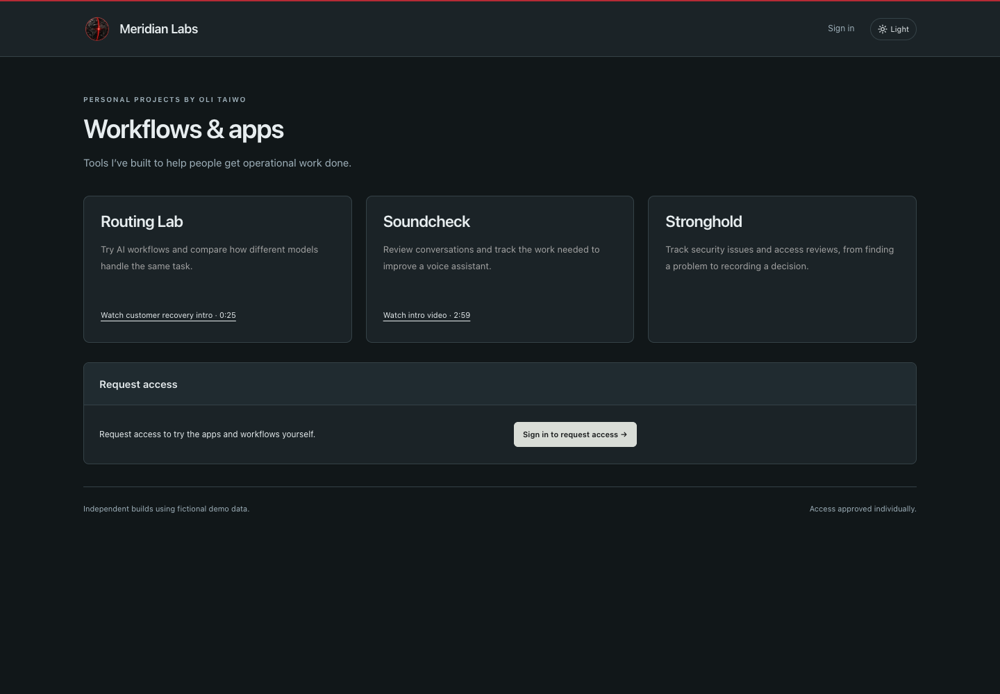
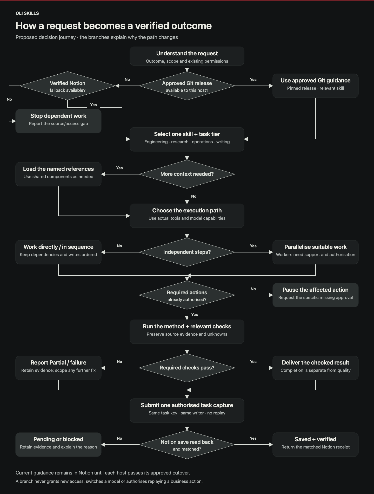
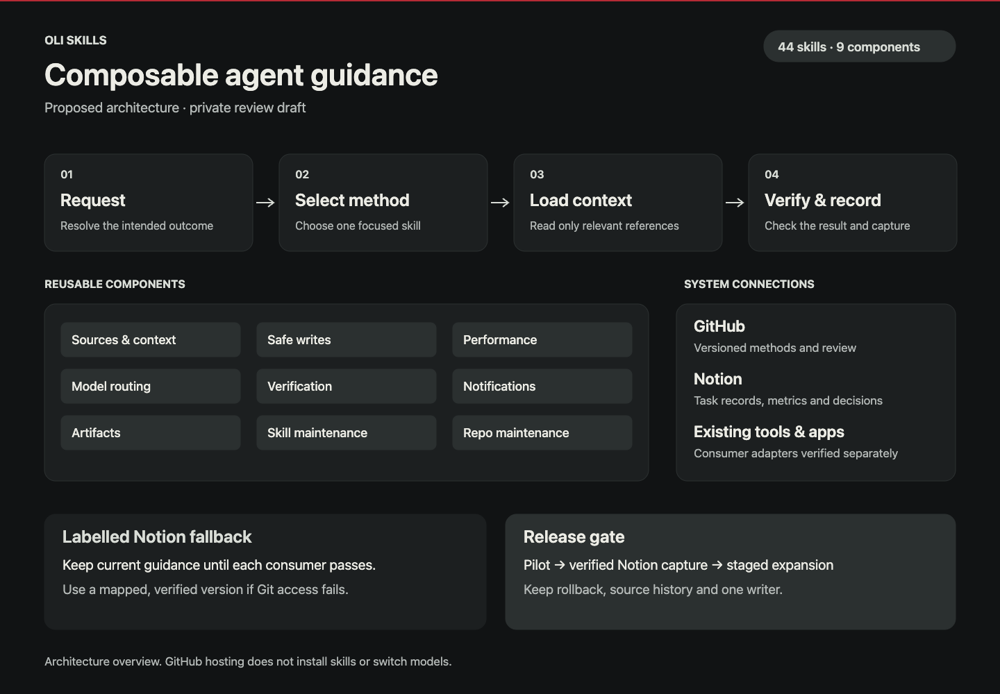
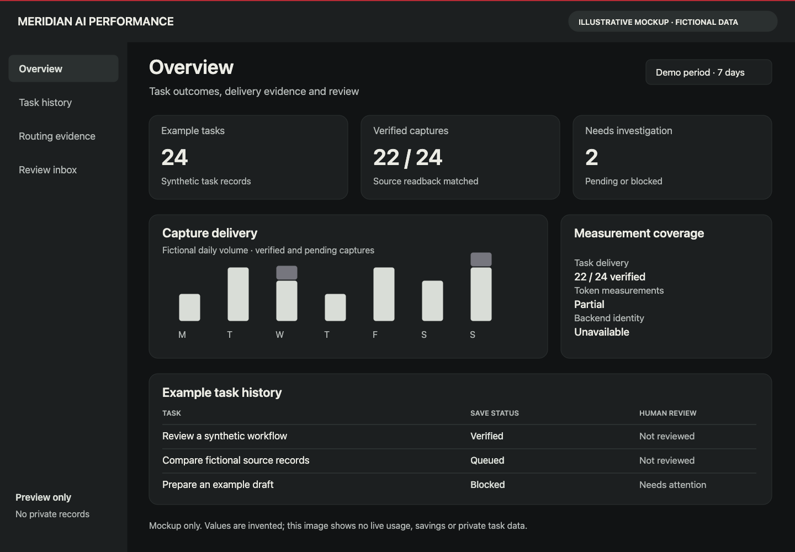

# Hi, I’m Oli

I build AI applications and workflow automation with Python, TypeScript and n8n.

My work covers how systems fit together: integrations, reusable components, testing, evaluation and the operational processes needed to maintain them.

## Projects

### Meridian Labs

The entry point to my wider AI engineering work. Applications, workflow examples and tools exploring model routing, source evidence, evaluation and human review.

### Oli Skills

A reusable agent-skills architecture currently in development. Small, focused instructions share common components for engineering, research, reporting and repository maintenance, with versioned guidance and staged rollout.

Shared components and system connections

### Meridian AI Performance

*Illustrative mockup with fictional data.*

Metrics and review tooling for understanding AI work. Connects task outcomes, execution evidence and available usage measurements while keeping automated assessments and human decisions separate.

## How I build

I use small interfaces, shared components and tests suited to the behaviour being changed. Changes go through pull requests, with documentation maintained alongside the implementation.

I’m particularly interested in making AI systems easier to inspect, evaluate and operate, and using observed failures to improve the next version.

---

Implementation repositories are private. This profile shares selected project summaries.
